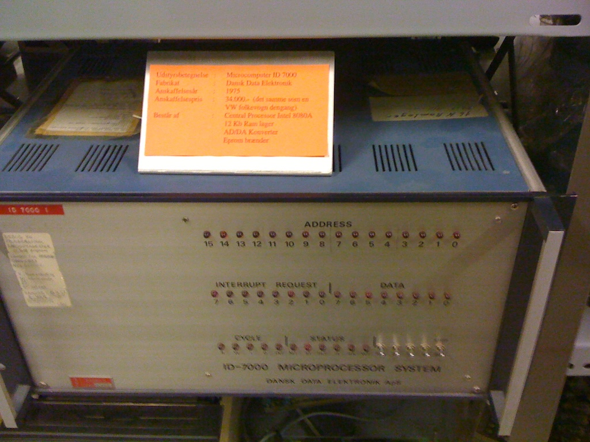
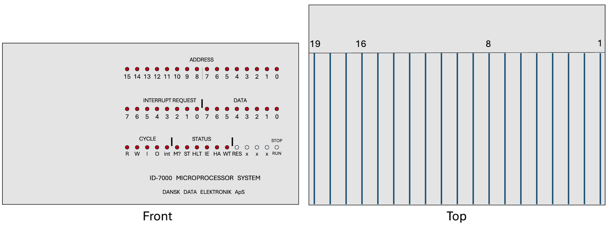
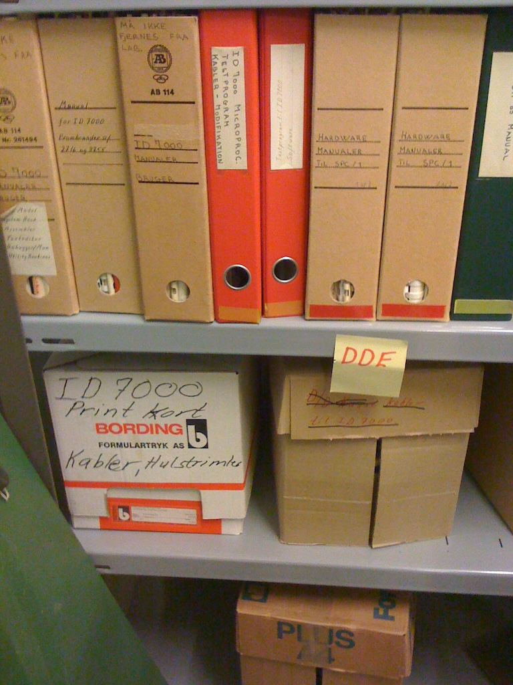
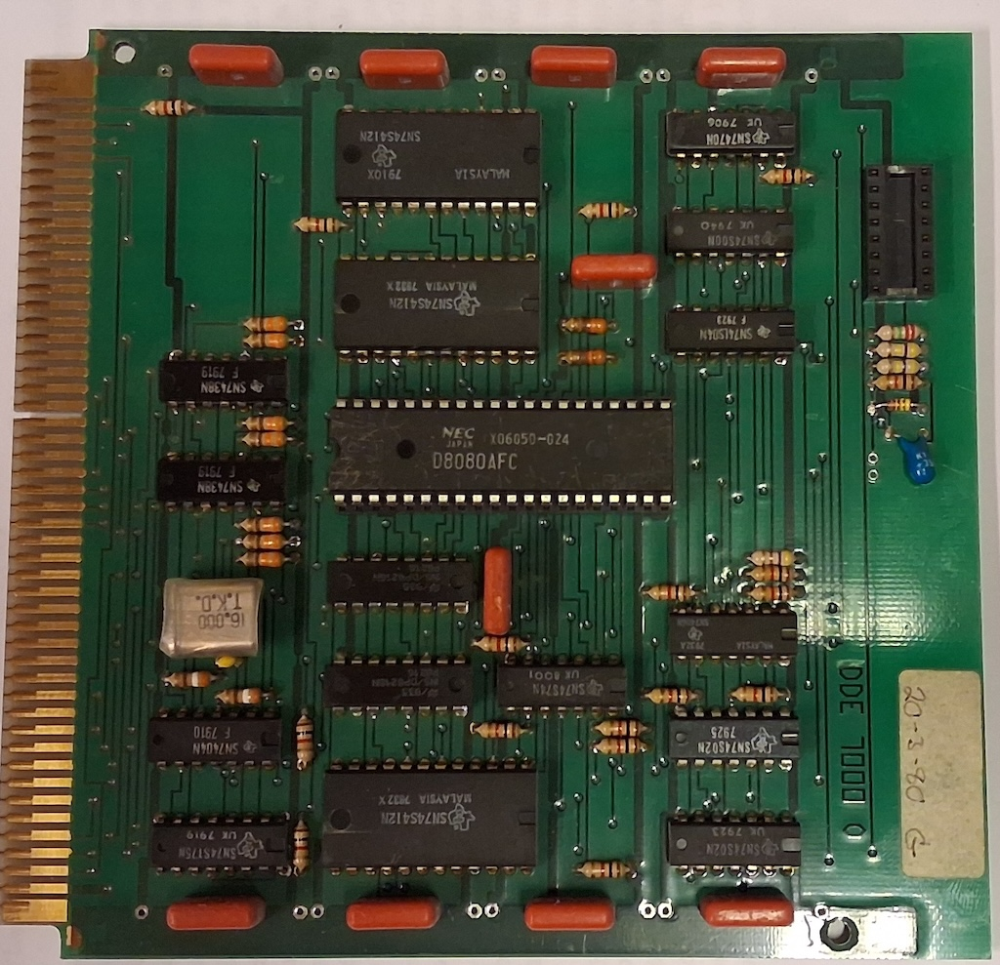
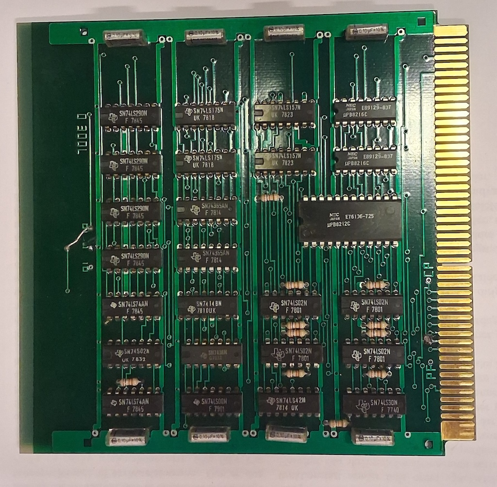
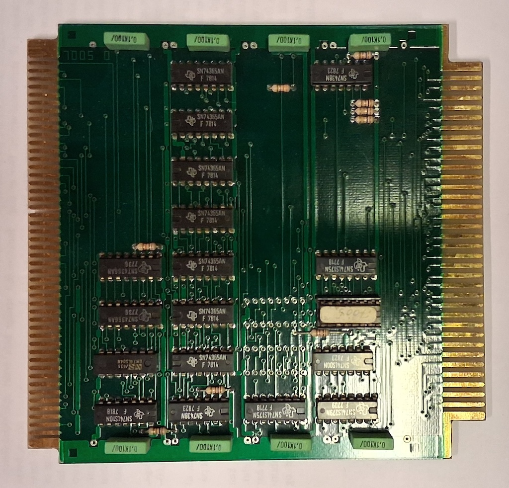
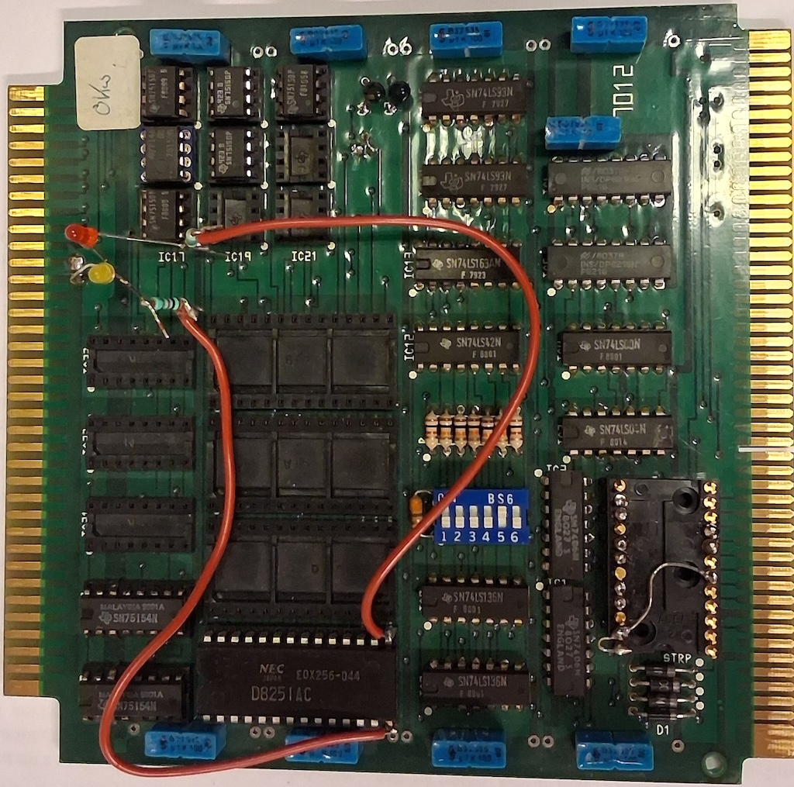
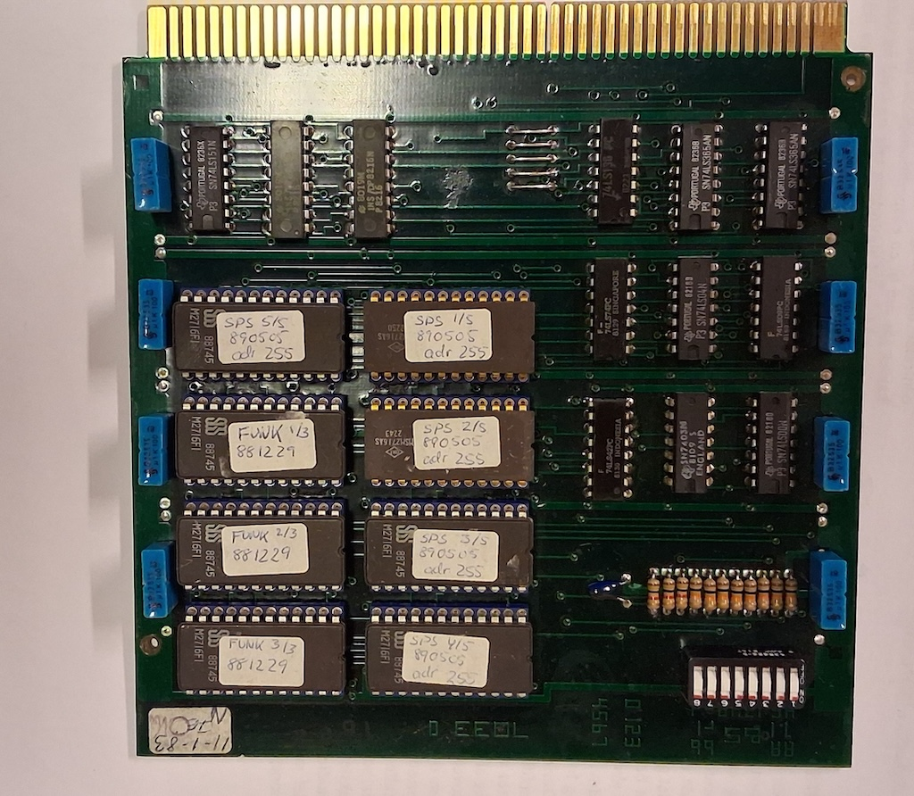

Background Information
======================

Dansk Data Elektronik is a danish company established in 1975. DDE produced, among
other computers and electronics, a modular microcomputer based on the i8080
processor named **ID-7000**.

The story of DDE and ID-7000 is being told by the danish 'Computer History Museum'
Dansk Datahistorisk Forening (DDF). This repository is not aiming to cover 
any DDF scope regarding DDE as a company, its influence on the danish electronics 
industry or its historical milestones.

The purpose of this repository is to

* provide working emulators for ID-7000 variants and/or their peripherals
* analyse the CPU software, programs and IO usages
* establish the configuration of one or more ID-7000 systems in DDF's custody
* present the relevant technical documentation that was used in the process

All in order to preserve a virtual ID-7000 for the future and to allow others 
to pick up on this effort and correct and improve it.

  DDE ID7000 (A)

DDF has photos of PCBs, ID-7000 chassis, digitised ROMs and paper tapes as 
well as scanned manuals and other documentation. 

For an overview of all ID-7000 labelled artifacts:
https://datamuseum.dk/wiki/Bits:Keyword/DDE/ID-7000

Information about DDE
---------------------

https://datamuseum.dk/wiki/Dansk_Data_Elektronik_A/S
https://da.wikipedia.org/wiki/Dansk_Data_Elektronik
https://lex.dk/Dansk_Data_Elektronik

.. _id7000_variants:

Known ID-7000s
==============

According to legend (Poul Henning Kamp) DDF is in possession of seven Id-7000s.
There will eventually be a visit to the storehouse to check these out.

  Chassis drawing, front and top view with board slot enumeration.

This is a list of the ID-7000s that have been part of this investigation so far.

ID-7000 A (virtual)
-------------------

This ID-7000 is not yet associated with any particular chassis from DDF.

The ROMs I used for the exploration and emulator were located on what is named
Board 5 in the bitarchive: https://datamuseum.dk/wiki/Bits:30007085 which was
almost, but not entirely, picked at random.

ID-7000 B
---------

This ID-7000 was rescued by Jørgen Albretsen. He writes:

    "Jeg var den, der reddede den pågældende ID-7000 fra at blive smidt ud fra Aalborg
    Universitet. Men nøjagtigt hvad den er blevet brugt til, ved jeg ikke. Vedlagt et
    par billeder fra redningen, som skete i panik [removed text], så ikke alt kom med.
    Finn har billeder. Men prøv at lokalisere de manualer og andet skriftligt, der vises
    på et af billederne. De må enten være i bitarkivet eller et sted på Sjælland i et
    fjernarkiv. Kunne fortælle mere. Mit gæt på brug er undervisning i proceskontrol el.
    lign. for ingeniørstuderende på Aalborg Universitetscenter (startet 1974, ID-7000
    indkøbt 1975 ref. billede, undervisning i EPROM forårssemester 1983 ref. print fra
    emulator). AD-DA, EPROM dertil...""

  Manuals, documentation and ROMs in storage

It is currently not known what (PCB) modules it contains.

ID-7000 SPS
-----------

This one is on display at the museum. It is currently named by the title 
of the ROM image. I should really have checked the labels at the back
to identify it by the previuos owner.

It has the following boards installed (examined at datamuseum 2026 10 22).

.. list-table::
   :header-rows: 1
   :widths: 22 18 60

   * - Slot
     - Board
     - Description
   * - 1
     - ID-7005
     - Manual Control Module
   * - 2
     - ID-7000
     - CPU Module
   * - 4
     - ID-7007?
     - RAM (xx kB)
   * - 5
     - ID-7003
     - Interrupt/timer (10ms timer interrupt)
   * - 7
     - ID-7037
     - DRAM
   * - 9
     - n/a
     - Parallel extension/debug board (no function)
   * - 11
     - ID-7033
     - ROM (SPS 1-5 + FUNK 1-3)
   * - 13
     - ID-7038
     - Unknown so far (lots of LM74xxx)
   * - 15
     - ID-7012
     - Synchronous Data Communication Transmitter

DDE 7000
^^^^^^^^

  CPU module (1980 03 20)

https://datamuseum.dk/bits/30005393

Contains the following main ICs

D8080AFC

SN74S412N MULTI-MODE BUFFERED LATCHES x3

DDE 7003
^^^^^^^^

  Interrupt priority Module

https://datamuseum.dk/bits/30005402

Contains the following main ICs

uPB8212 8 bit I/O port

DDE 7005
^^^^^^^^

  Manual Control Module

https://datamuseum.dk/bits/30005404

DDE 7012
^^^^^^^^

  4-port Async./sync. communication module

https://datamuseum.dk/bits/30005408

Contains the following main ICs

D8251AC (1 out of 4 possible)

DDE 7033
^^^^^^^^

  ROM Module 16KB (83 01 11)

No documentation but presumably an evolution of the
`DDE 7001 <https://datamuseum.dk/bits/30005399 />`_  board
which only allowed up to 8KB.

Contains the following main ICs

MSM2716AS EPROM 2k x 8 bit

Known software images
=====================

TBA
