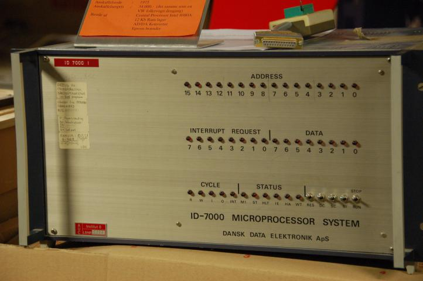

ID-7000 Emulator
================

Documentation for emulating the
`DDE ID-7000 <https://datamuseum.dk/wiki/DDE_ID-7000>`_
from ROMs.

  DDE ID7000

.. toctree::
    :maxdepth: 3
    :caption: ID7000 A

    id7000_a/info
    id7000_a/log
    id7000_a/annotate
    emulator/emulator

.. toctree::
    :maxdepth: 3
    :caption: ID7000 A - Claude

    id7000_a/claude_reveng
    id7000_a/claude_peripheral_init
    id7000_a/claude_id7000_rom
    id7000_a/claude_emulator

.. toctree::
    :maxdepth: 3
    :caption: ID7000 SPS/FUNK

    id7000_sps/info

.. toctree::
    :maxdepth: 3
    :caption: ID7000 SPS - Claude
    id7000_sps/claude_sps_funk
