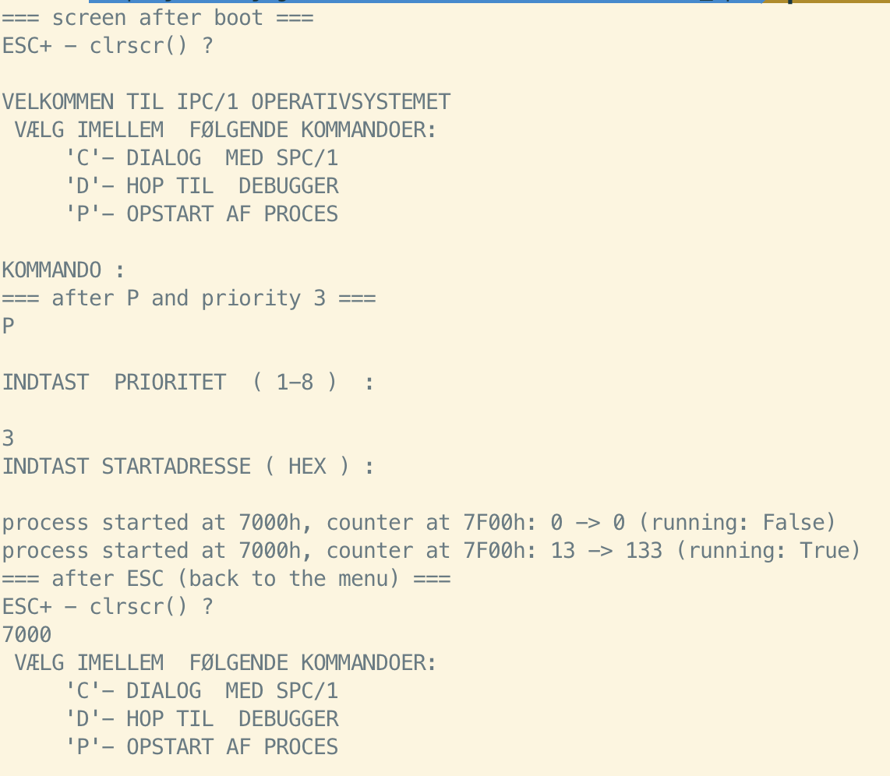
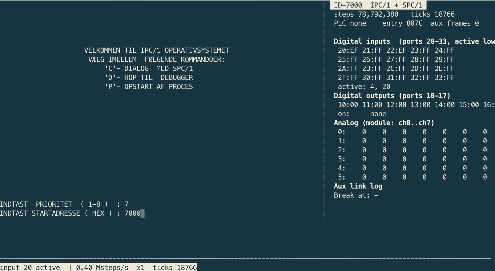
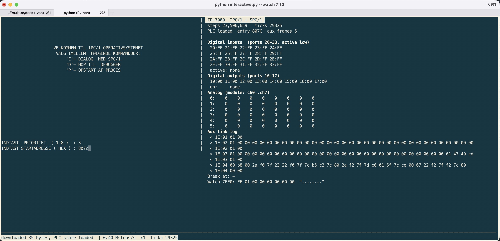

Log book
========
This project started around November 22, 2024. Some code was quickly put
together based on the building blocks from the Q1 emulator project.

A github repo was created March 20 2025. Log entries before then have been
resonstructed from memory and emails.

The logbook covers what happens on specific dates and as such it may jump 
between different ID-7000 configurations such as **ID-7000 A** and **ID 7000 SPS**.

See :ref:`id7000_variants` for a list of known ID7000s and ROM images.

2024 11 29
----------

**ID-7000 A**

Emulator is running. Log entry in danish copied from an email to DDF mailinglist.

.. code-block:: text

  Jeg har kikket i bitarkivet for ID-7000, fundet nogle prom images, nogle datablade, gættet lidt og
  valgt et (forhåbentlig) passende image at starte med.

  Dette image er så forsøgt emuleret med hjælp fra kode genbrugt fra Q1 emulatoren.

  Så vidt jeg kan se kører koden som den skal: RAM bliver initialiseret og der bliver lavet
  RAM og PROM checks.

  Jeg kan f.eks. fremprovokere en fejlmeddelelse ved at fake forkert skrivning i nogle RAM
  adresser:

    4.870: 60 out - 30 (0)
    4.871: 60 out - 07 (.)
    4.871: ** ERROR IN RAM MEMORY DETECTED IN HEX AREA 7000-8000
    4.871: 60 out - 07 (.)

  ID-7000 benytter en masse IO adresser: Der er (initielt) identisk output
  (0x03 0x53 0xfa 0x25 '.S.%') på 12 IO adresser 0x61, 0x63, 0x65, 0x67, 69, 6b, 6d, 6f,71, 73,
  75 og 0x77. Men det er ikke en sekvens der siger mig noget.

  I RAM ser det ud til at der bliver kopieret tekst fra PROM i flere lokationer. Heraf 12 med
  identisk tekst der ligner en prompt:

  42a0 41 5b 43 59 42 45 52 20 4c 49 4e 4b 3a 20 53 49  A[CYBER LINK: SI
  42b0 54 45 20 41 44 44 52 45 53 53 20 31 20 20 20 4e  TE ADDRESS 1   N
  42c0 4f 54 20 41 43 54 49 56 45 5d 1b 41 99 fe 98 fe  OT ACTIVE].A....
  ...
  4f40 5f 1b 41 49 44 2d 37 30 30 30 20 2a 52 45 41 44  _.AID-7000 *READ
  4f50 59 2a 20 28 32 30 30 55 54 2f 53 49 4d 29 20 56  Y* (200UT/SIM) V
  4f60 45 52 53 49 4f 4e 20 30 31 2e 30 32 2e 38 33 1b  ERSION 01.02.83.
  ...
  5360 4f f6 7a 71 4d 1b 41 49 44 2d 37 30 30 30 20 2a O..qM.AID-7000 *
  5370 52 45 41 44 59 2a 20 28 32 30 30 55 54 2f 53 49  READY* (200UT/SI
  5380 4d 29 20 56 45 52 53 49 4f 4e 20 30 31 2e 30 32  M) VERSION 01.02
  5390 2e 38 33 1b 41 f6 34 f6 33 f6 32 f6 31 f6 30 f6 .83.A.4.3.2.1.0.
  ...
  5780 3f f4 3e f4 3d f4 79 71 3b 1b 41 49 44 2d 37 30 ?.>.=.yq;.AID-70
  5790 30 30 20 2a 52 45 41 44 59 2a 20 28 32 30 30 55  00 *READY* (200U
  57a0 54 2f 53 49 4d 29 20 56 45 52 53 49 4f 4e 20 30  T/SIM) VERSION 0
  57b0 31 2e 30 32 2e 38 33 1b 41 f4 22 f4 21 f4 20 f4 1.02.83.A.".!. .
  ...
  5ba0 2f f2 2e f2 2d f2 2c f2 2b f2 78 71 29 1b 41 49 /...-.,.+.xq).AI
  5bb0 44 2d 37 30 30 30 20 2a 52 45 41 44 59 2a 20 28  D-7000 *READY* (
  5bc0 32 30 30 55 54 2f 53 49 4d 29 20 56 45 52 53 49  200UT/SIM) VERSI
  5bd0 4f 4e 20 30 31 2e 30 32 2e 38 33 1b 41 f2 10 f2  ON 01.02.83.A...
  ...
  5fd0 17 1b 41 49 44 2d 37 30 30 30 20 2a 52 45 41 44  ..AID-7000 *READ
  5fe0 59 2a 20 28 32 30 30 55 54 2f 53 49 4d 29 20 56  Y* (200UT/SIM) V
  5ff0 45 52 53 49 4f 4e 20 30 31 2e 30 32 2e 38 33 1b  ERSION 01.02.83.
  ...
  63f0 07 ee 76 71 05 1b 41 49 44 2d 37 30 30 30 20 2a ..vq..AID-7000 *
  6400 52 45 41 44 59 2a 20 28 32 30 30 55 54 2f 53 49  READY* (200UT/SI
  6410 4d 29 20 56 45 52 53 49 4f 4e 20 30 31 2e 30 32  M) VERSION 01.02
  6420 2e 38 33 1b 41 ed ec ed eb ed ea ed e9 ed e8 ed .83.A...........
  ...
  6810 f7 eb f6 eb f5 eb 75 71 f3 1b 41 49 44 2d 37 30 ......uq..AID-70
  6820 30 30 20 2a 52 45 41 44 59 2a 20 28 32 30 30 55  00 *READY* (200U
  6830 54 2f 53 49 4d 29 20 56 45 52 53 49 4f 4e 20 30  T/SIM) VERSION 0
  6840 31 2e 30 32 2e 38 33 1b 41 eb da eb d9 eb d8 eb 1.02.83.A.......
  ...
  6c30 e7 e9 e6 e9 e5 e9 e4 e9 e3 e9 74 71 e1 1b 41 49 ..........tq..AI
  6c40 44 2d 37 30 30 30 20 2a 52 45 41 44 59 2a 20 28  D-7000 *READY* (
  6c50 32 30 30 55 54 2f 53 49 4d 29 20 56 45 52 53 49  200UT/SIM) VERSI
  6c60 4f 4e 20 30 31 2e 30 32 2e 38 33 1b 41 e9 c8 e9  ON 01.02.83.A...
  ...
  7060 cf 1b 41 49 44 2d 37 30 30 30 20 2a 52 45 41 44  ..AID-7000 *READ
  7070 59 2a 20 28 32 30 30 55 54 2f 53 49 4d 29 20 56  Y* (200UT/SIM) V
  7080 45 52 53 49 4f 4e 20 30 31 2e 30 32 2e 38 33 1b  ERSION 01.02.83.
  ...
  7470 c7 e5 c6 e5 c5 e5 c4 e5 c3 e5 c2 e5 c1 e5 c0 e5 ................
  7480 bf e5 72 71 bd 1b 41 49 44 2d 37 30 30 30 20 2a ..rq..AID-7000 *
  7490 52 45 41 44 59 2a 20 28 32 30 30 55 54 2f 53 49  READY* (200UT/SI
  74a0 4d 29 20 56 45 52 53 49 4f 4e 20 30 31 2e 30 32  M) VERSION 01.02
  74b0 2e 38 33 1b 41 e5 a4 e5 a3 e5 a2 e5 a1 e5 a0 e5 .83.A...........
  ...
  78a0 af e3 ae e3 ad e3 71 71 ab 1b 41 49 44 2d 37 30 ......qq..AID-70
  78b0 30 30 20 2a 52 45 41 44 59 2a 20 28 32 30 30 55  00 *READY* (200U
  78c0 54 2f 53 49 4d 29 20 56 45 52 53 49 4f 4e 20 30  T/SIM) VERSION 0
  78d0 31 2e 30 32 2e 38 33 1b 41 e3 92 e3 91 e3 90 e3 1.02.83.A.......
  ...
  7cc0 9f e1 9e e1 9d e1 9c e1 9b e1 70 71 99 1b 41 49 ..........pq..AI
  7cd0 44 2d 37 30 30 30 20 2a 52 45 41 44 59 2a 20 28  D-7000 *READY* (
  7ce0 32 30 30 55 54 2f 53 49 4d 29 20 56 45 52 53 49  200UT/SIM) VERSI
  7cf0 4f 4e 20 30 31 2e 30 32 2e 38 33 1b 41 e1 80 e1  ON 01.02.83.A...

  Det ser ud til at systemet nu venter på en passende interrupt, men jeg har endnu ikke
  findet nogen beskrivelse af dette.

  Inden jeg kører videre ud af en tangent skal jeg lige høre om der er nogen der allerede har
  opnået lignende resultater, om dette har interesse,  og om der er nogen der ved lidt mere
  om systemet?

2025 03 20
----------

**ID-7000 A**

Github repo created and the project was populated with the latest files.

2025 03 25
----------

**ID-7000 A**

Added two flags --ramerr and --romerr used to simulate RAM and ROM errors.
These cause printing of error messages to what is presumably
a terminal. Here is the output (using utils/logio) from two runs:

.. code-block:: text

  0.009: fe out - 00 (.)
  0.009: 61 out - 03 (.)
  0.009: 61 out - 53 (S)
  0.009: 61 out - fa (.)
  0.009: 61 out - 25 (%)
  0.841: ** ERROR IN RAM MEMORY DETECTED IN HEX AREA ** ERROR IN PROM MEMORY DETECTED **

  0.009: fe out - 00 (.)
  0.009: 61 out - 53 (S)
  0.009: 61 out - fa (.)
  0.010: 61 out - 25 (%)
  4.241: ** ERROR IN RAM MEMORY DETECTED IN HEX AREA 6000-7000

2026 10 13
----------

**ID-7000 A**

Been playing around with the use of shared memory as a convenient 
way of live debugging various address ranges of the 64k address 
space. Did a proof of concept but couldn't get it to work.

2026 10 15
----------

**ID-7000 A**

emulator read/write callbacks
^^^^^^^^^^^^^^^^^^^^^^^^^^^^^

It turns out that there was a new handling of read/write callbacks
in the emulator. Now I have to register the address space that is
used in the callback. So after the emulator update nothing worked.

I found the correct spells and now it works again. Luckily, during 
the hunt for why I couldn't trigger ROM and RAM errors anymore I
added a lot of annotations of interesting functionality.

And as a result my shared memory debug now works!

Initialised RAM areas
^^^^^^^^^^^^^^^^^^^^^

After a bit of a renewed interest I managed to extract the 'active' part of 
RAM after initial setup following RAM and ROM tests.

At this stage the CPU is halted asfar as I can tell and is awaiting some 
relevant interrupt in order to do anything. This is to be investigated next
perhaps.

.. code-block:: text

  excluding ROM section from 0x0000 to 0x1a30

  4000 03 30 f9 41 00 ff fc 02 fb ff fa 00 f9 ff f8 ff  .0.A............

  4040 df ff de ff dd ff dc ff ca 7c 35 a2 17 a2 ae a2  .........|5.....
  4050 0b 01 ae a1 d5 ff d4 ff d3 ff d2 ff d1 ff d0 ff  ................

  41f0 07 ff 06 ff 05 ff 04 ff 03 69 08 54 40 03 03 76  .........i.T@..v
  4200 76 00 00 00 00 05 19 9a 40 01 01 76 76 00 00 00  v.......@..vv...
  4210 00 75 0a e0 40 01 03 76 76 00 00 00 00 ff ff e0  .u..@..vv.......
  4220 02 f8 41 01 1e fe ec fe eb fe ea 00 00 00 00 00  ..A.............
  4230 00 00 00 00 00 00 00 00 00 00 00 00 00 00 00 00  ................
  4240 00 00 00 00 00 00 00 00 00 00 00 00 00 00 00 00  ................
  4250 00 00 00 00 00 00 00 00 00 00 00 00 00 00 00 00  ................
  4260 00 00 00 00 00 00 00 00 00 00 00 00 00 00 00 00  ................
  4270 00 00 00 00 00 00 00 00 00 00 00 00 00 00 00 00  ................
  4280 00 00 00 00 00 00 00 00 00 00 00 00 00 00 00 00  ................
  4290 00 00 00 00 00 00 00 00 00 00 00 00 00 01 2e 1b  ................

  42a0 41 5b 43 59 42 45 52 20 4c 49 4e 4b 3a 20 53 49  A[CYBER LINK: SI
  42b0 54 45 20 41 44 44 52 45 53 53 20 31 20 20 20 4e  TE ADDRESS 1   N
  42c0 4f 54 20 41 43 54 49 56 45 5d 1b 41 99 fe 98 fe  OT ACTIVE].A....

  4f30 67 f8 66 f8 65 f8 64 f8 63 f8 62 f8 61 f8 7b 71  g.f.e.d.c.b.a.{q
  4f40 5f 1b 41 49 44 2d 37 30 30 30 20 2a 52 45 41 44  _.AID-7000 *READ
  4f50 59 2a 20 28 32 30 30 55 54 2f 53 49 4d 29 20 56  Y* (200UT/SIM) V
  4f60 45 52 53 49 4f 4e 20 30 31 2e 30 32 2e 38 33 1b  ERSION 01.02.83.
  4f70 41 f8 46 f8 45 f8 44 f8 43 f8 42 f8 41 f8 40 f8  A.F.E.D.C.B.A.@.

  5360 4f f6 7a 71 4d 1b 41 49 44 2d 37 30 30 30 20 2a  O.zqM.AID-7000 *
  5370 52 45 41 44 59 2a 20 28 32 30 30 55 54 2f 53 49  READY* (200UT/SI
  5380 4d 29 20 56 45 52 53 49 4f 4e 20 30 31 2e 30 32  M) VERSION 01.02
  5390 2e 38 33 1b 41 f6 34 f6 33 f6 32 f6 31 f6 30 f6  .83.A.4.3.2.1.0.

  5780 3f f4 3e f4 3d f4 79 71 3b 1b 41 49 44 2d 37 30  ?.>.=.yq;.AID-70
  5790 30 30 20 2a 52 45 41 44 59 2a 20 28 32 30 30 55  00 *READY* (200U
  57a0 54 2f 53 49 4d 29 20 56 45 52 53 49 4f 4e 20 30  T/SIM) VERSION 0
  57b0 31 2e 30 32 2e 38 33 1b 41 f4 22 f4 21 f4 20 f4  1.02.83.A.".!. .

  5ba0 2f f2 2e f2 2d f2 2c f2 2b f2 78 71 29 1b 41 49  /...-.,.+.xq).AI
  5bb0 44 2d 37 30 30 30 20 2a 52 45 41 44 59 2a 20 28  D-7000 *READY* (
  5bc0 32 30 30 55 54 2f 53 49 4d 29 20 56 45 52 53 49  200UT/SIM) VERSI
  5bd0 4f 4e 20 30 31 2e 30 32 2e 38 33 1b 41 f2 10 f2  ON 01.02.83.A...

  5fc0 1f f0 1e f0 1d f0 1c f0 1b f0 1a f0 19 f0 77 71  ..............wq
  5fd0 17 1b 41 49 44 2d 37 30 30 30 20 2a 52 45 41 44  ..AID-7000 *READ
  5fe0 59 2a 20 28 32 30 30 55 54 2f 53 49 4d 29 20 56  Y* (200UT/SIM) V
  5ff0 45 52 53 49 4f 4e 20 30 31 2e 30 32 2e 38 33 1b  ERSION 01.02.83.
  6000 41 ef fe ef fd ef fc ef fb ef fa ef f9 ef f8 ef  A...............

  63f0 07 ee 76 71 05 1b 41 49 44 2d 37 30 30 30 20 2a  ..vq..AID-7000 *
  6400 52 45 41 44 59 2a 20 28 32 30 30 55 54 2f 53 49  READY* (200UT/SI
  6410 4d 29 20 56 45 52 53 49 4f 4e 20 30 31 2e 30 32  M) VERSION 01.02
  6420 2e 38 33 1b 41 ed ec ed eb ed ea ed e9 ed e8 ed  .83.A...........

  6810 f7 eb f6 eb f5 eb 75 71 f3 1b 41 49 44 2d 37 30  ......uq..AID-70
  6820 30 30 20 2a 52 45 41 44 59 2a 20 28 32 30 30 55  00 *READY* (200U
  6830 54 2f 53 49 4d 29 20 56 45 52 53 49 4f 4e 20 30  T/SIM) VERSION 0
  6840 31 2e 30 32 2e 38 33 1b 41 eb da eb d9 eb d8 eb  1.02.83.A.......

  6c30 e7 e9 e6 e9 e5 e9 e4 e9 e3 e9 74 71 e1 1b 41 49  ..........tq..AI
  6c40 44 2d 37 30 30 30 20 2a 52 45 41 44 59 2a 20 28  D-7000 *READY* (
  6c50 32 30 30 55 54 2f 53 49 4d 29 20 56 45 52 53 49  200UT/SIM) VERSI
  6c60 4f 4e 20 30 31 2e 30 32 2e 38 33 1b 41 e9 c8 e9  ON 01.02.83.A...

  7050 d7 e7 d6 e7 d5 e7 d4 e7 d3 e7 d2 e7 d1 e7 73 71  ..............sq
  7060 cf 1b 41 49 44 2d 37 30 30 30 20 2a 52 45 41 44  ..AID-7000 *READ
  7070 59 2a 20 28 32 30 30 55 54 2f 53 49 4d 29 20 56  Y* (200UT/SIM) V
  7080 45 52 53 49 4f 4e 20 30 31 2e 30 32 2e 38 33 1b  ERSION 01.02.83.
  7090 41 e7 b6 e7 b5 e7 b4 e7 b3 e7 b2 e7 b1 e7 b0 e7  A...............

  7480 bf e5 72 71 bd 1b 41 49 44 2d 37 30 30 30 20 2a  ..rq..AID-7000 *
  7490 52 45 41 44 59 2a 20 28 32 30 30 55 54 2f 53 49  READY* (200UT/SI
  74a0 4d 29 20 56 45 52 53 49 4f 4e 20 30 31 2e 30 32  M) VERSION 01.02
  74b0 2e 38 33 1b 41 e5 a4 e5 a3 e5 a2 e5 a1 e5 a0 e5  .83.A...........

  78a0 af e3 ae e3 ad e3 71 71 ab 1b 41 49 44 2d 37 30  ......qq..AID-70
  78b0 30 30 20 2a 52 45 41 44 59 2a 20 28 32 30 30 55  00 *READY* (200U
  78c0 54 2f 53 49 4d 29 20 56 45 52 53 49 4f 4e 20 30  T/SIM) VERSION 0
  78d0 31 2e 30 32 2e 38 33 1b 41 e3 92 e3 91 e3 90 e3  1.02.83.A.......

  7cc0 9f e1 9e e1 9d e1 9c e1 9b e1 70 71 99 1b 41 49  ..........pq..AI
  7cd0 44 2d 37 30 30 30 20 2a 52 45 41 44 59 2a 20 28  D-7000 *READY* (
  7ce0 32 30 30 55 54 2f 53 49 4d 29 20 56 45 52 53 49  200UT/SIM) VERSI
  7cf0 4f 4e 20 30 31 2e 30 32 2e 38 33 1b 41 e1 80 e1  ON 01.02.83.A...

  a180 3f cf 3e cf 3d cf 3c cf 3b cf 02 00 d2 42 f5 46  ?.>.=.<.;....B.F
  a190 d5 42 d2 42 01 05 f6 46 19 4b f9 46 f6 46 00 05  .B.B...F.K.F.F..
  a1a0 1a 4b 3d 4f 1d 4b 1a 4b 01 06 3e 4f 61 53 71 4f  .K=O.K.K..>OaSqO
  a1b0 41 4f 01 06 62 53 85 57 95 53 65 53 01 06 86 57  AO..bS.W.SeS...W
  a1c0 a9 5b b9 57 89 57 01 06 aa 5b cd 5f dd 5b ad 5b  .[.W.W...[._.[.[
  a1d0 01 06 ce 5f f1 63 01 60 d1 5f 01 06 f2 63 15 68  ..._.c.`._...c.h
  a1e0 25 64 f5 63 01 06 16 68 39 6c 49 68 19 68 01 06  %d.c...h9lIh.h..
  a1f0 3a 6c 5d 70 6d 6c 3d 6c 01 06 5e 70 81 74 91 70  :l]pml=l..^p.t.p
  a200 61 70 01 06 82 74 a5 78 b5 74 85 74 01 06 a6 78  ap...t.x.t.t...x
  a210 c9 7c d9 78 a9 78 01 06 ca 7c ed 80 fd 7c cd 7c  .|.x.x...|...|.|
  a220 ff ff ee 80 11 85 f1 80 ee 80 ff ff 12 85 35 89  ..............5.
  a230 15 85 12 85 00 00 36 89 3c 8b 39 89 36 89 00 00  ......6.<.9.6...
  a240 3d 8b 43 8d 40 8b 3d 8b 00 00 44 8d 4a 8f 47 8d  =.C.@.=...D.J.G.
  a250 44 8d 00 00 4b 8f 51 91 4e 8f 4b 8f 00 00 52 91  D...K.Q.N.K...R.
  a260 58 93 55 91 52 91 00 00 59 93 5f 95 5c 93 59 93  X.U.R...Y._.\.Y.
  a270 00 00 60 95 66 97 63 95 60 95 00 00 67 97 6d 99  ..`.f.c.`...g.m.
  a280 6a 97 67 97 00 00 6e 99 74 9b 71 99 6e 99 00 00  j.g...n.t.q.n...
  a290 75 9b 7b 9d 78 9b 75 9b 00 00 7c 9d 82 9f 7f 9d  u.{.x.u...|.....
  a2a0 7c 9d 00 00 83 9f 89 a1 86 9f 83 9f a9 6e 8c 64  |............n.d
  a2b0 82 5a 78 50 6e 46 64 3c 5a 32 50 28 46 1e 3c 14  .ZxPnFd<Z2P(F.<.
  a2c0 32 0a 28 00 1e ce 9c ce 9b ce 9a ce 99 14 0a 00  2.(.............
  a2d0 97 ce 00 00 00 00 00 00 00 00 00 00 00 00 00 00  ................
  a2e0 00 00 8e ce 8d ce 8c ce 8b ce 8a ce 89 ce 88 ce  ................
  a2f0 87 ce ff ce 85 ce 84 00 00 04 00 00 81 ce 00 ce  ................
  a300 7f ce 00 00 7d ce 7c ce 7b 61 61 61 61 61 61 61  ....}.|.{aaaaaaa
  a310 61 61 61 61 61 ce 74 ce 73 ce 72 ce 71 ce 70 ce  aaaaa.t.s.r.q.p.

INTx attempts
^^^^^^^^^^^^^

A brief visit at Datamuseum where I took some photos of the boards installed
in their ID-7000.

While here I tried to create some fake interrupts. First I tried INT6 at 
address 0x30 which I thought was terminal input (could still be the case).
But that didn't trigger any visible changes in the parts of RAM I was running
shmem_hexdump from.

Then I tried another one (INT3 at address 0x18) hoping that it could be a
timer interrupt. I guessed this based on the code using in (0xff) an
address used (according to the documentation) for interrupts and timers.

So I faked an INT3 by the keyboard command opt-h and noticed watched memory
address 0x429b (see disassembly for RST3) for the expected decrement in that 
address.

Calling INT3 three times crashed the emulator because of missing implementations 
of various out() callbacks in z80io.py which were then successively added.

Once the final missing out() callback was added I notices a flurry of out() commands.

Buffering up the characters sent on out (0x60) and printing the buffer on the 
value 10 (ascii NL) I got

.. code-block:: text

    ID-7000 *READY* (200UT/SIM) VERSION 01.02.83

This text is 'printed' on all 12 suspected terminal IO channels.

This is a major finding so far. It establishes that 12 'terminal lines' or something
equivalent are supported and that their io addresses are

.. code-block:: text
  
  0x60 T1 data in/out
  0x61 T1 status/control
  0x62 T2 data in/out
  0x63 T2 status/control
  ...
  0x76 T12 data in/out
  0x77 T12 status/control

Then from the IRQ and timer module manual I have

.. code-block:: text

  0xfe Interrupt config and status
  0xff Timer related (eventhough for now it looks like the in() value is unused/ignored)

Which only leaves the following io addresses unknown (so far)

.. code-block:: text

  0x53
  0xa1

2026 10 18
----------

**ID-7000 A**

New approach taken: upload ROMs to Google AI and Claude and see what that can do.

Essentially by parsing the ROMs both quickly figured out the same as I have spent days on.

I then proceeded to use Claude to write a python based emulator.

More about this later ...

2026 10 20
----------

**ID-7000 A**

Add screenshot of ID-7000 A emulation

2026 10 24
----------

**ID-7000 SPS**

Running the emulator on the SPS + FUNK roms with nice progress

  Claude emulator running SPS + FUNK roms (demo_console.py)

The image shows the result of emulating terminal input and output to the ID7000 SPS.

Initially there is a welcome message and a small program menu with
three options: C, D and P. Where P is a (assembler) program launcher.

'P' is selected and we are prompted for a program priority. We select priority 3.

The emulator verifies that the program is not running yet.

Then a start address for the program is asked for and provided (7000h) where a 
continuous counter loop is inserted. The program is launched.

The emulator verifies that the program is running.

We then type the escape character and we return to the main menu.

I have not yet checked at this point if the program is still running.

2026 10 26
----------

**ID-7000 SPS**

Palying with Claude's capabilities. Here asking for an interactive emulator. Didn't 
specify much but it spun up a curses application. We still don't know exactly what 
this ROM images does and currently only the process launch 'P' option seem to 
do something.

Run it as

.. code-block:: text

  > python interactive.py

  Interactive emulator

2026 10 31
----------

**ID-7000 SPS**

Finally understood enough of the SPS(PLC) loading and executing process to
be able to launch a program of my own. It is a simple 32-bit counter.

The necessary steps:

Compile the counter program

.. code-block:: text

    > python asm8080.py examples/ctr32.asm --hex examples/crt32.hex

Launch the emulator and watch address 7FF0H where the 32 bit counter resides

.. code-block:: text

    > python interactive.py --watch 7ff0

Load the program by entering the debugger menu (Ctrl-] L) and specify
the program name (examples/ctr32.hex).

Launch the program with 'P' followed by priority '3' (1 to 3 works) and launch
address 807C.

The counter now runs in the background and the main menu is still active.

  The ctr32 program, loaded at address 807C. Aux communication and watch address displayed.
